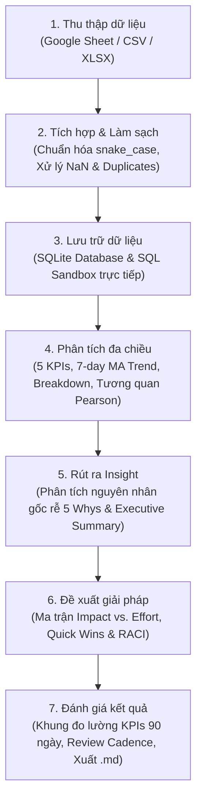

# StratAI • Trợ Lý AI Phân Tích Dữ Liệu & Giải Pháp Kinh Doanh

Hệ thống AI Agent phân tích kinh doanh đa chiều tự động hóa quy trình **7 bước nghiệp vụ** với giao diện hiện đại **Pastel Blue & Cream 3D**, tích hợp đầy đủ backend Python (FastAPI, SQLite, Pandas, Plotly/Chart.js).

---

## 🌐 Địa Chỉ Truy Cập Localhost
👉 **[http://localhost:8501](http://localhost:8501)**

---

## 📌 Kiến Trúc Quy Trình 7 Bước Tự Động Hóa



---

## 🚀 Các Điểm Nổi Bật của Giao Diện & Agent Mới

1. **Giao diện Mở Đầu (Hero Landing Page):**
   - Thiết kế chuẩn 3D Glassmorphism với tone màu Pastel Blue & Cream.
   - Thẻ nổi 3D động hiển thị tức thời tóm tắt báo cáo kinh doanh 7 bước.
   - Nạp nhanh 2 bộ dữ liệu thực tế (Bán lẻ 829 đơn & E-commerce Performance) chỉ với 1 click.

2. **Bảng Điều Khiển Workflow 7 Bước (Dashboard):**
   - **Thanh điều hướng ngang & dọc (Stepper):** Nhảy bước linh hoạt từ 1 đến 7 kèm biểu tượng trạng thái hoàn thành.
   - **Thanh công cụ Sliders trực tiếp:** Điều chỉnh ngưỡng cảnh báo chiết khấu sâu (15% - 50%) và trần hoàn hủy đơn hàng (5% - 25%).
   - **Bộ lọc tìm kiếm toàn cầu (Global Search):** Gõ từ khóa như `bán lỗ`, `chiết khấu`, `SQL`, `giải pháp`, `KPI` để tự động chuyển đến đúng bước tương ứng.

3. **Backend API Tích Hợp Sẵn (FastAPI + SQLite):**
   - `POST /api/upload`: Tải file `.csv`, `.xlsx`, `.xls` và chạy toàn bộ pipeline.
   - `POST /api/gsheet`: Trích xuất và nạp dữ liệu từ link Google Sheets công khai.
   - `POST /api/sample`: Nạp tức thì các dataset mẫu.
   - `POST /api/sql`: Chạy câu lệnh SQL thực tế trên cơ sở dữ liệu `data_storage.db`.
   - `POST /api/chat`: Kết nối Trợ lý Cố vấn Chiến lược (hỗ trợ nhập Gemini API Key hoặc chạy động cơ phân tích nội suy).

---

## 🛠️ Khởi Chạy Hệ Thống

Để khởi động lại hệ thống bất cứ lúc nào:
```bash
cd "/Users/vanahnn/Documents/Cuối Môn - AI301"
./run.sh
```
Mở trình duyệt tại: **`http://localhost:8501`**
